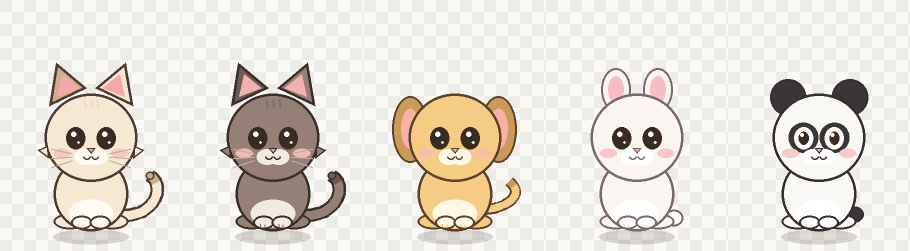
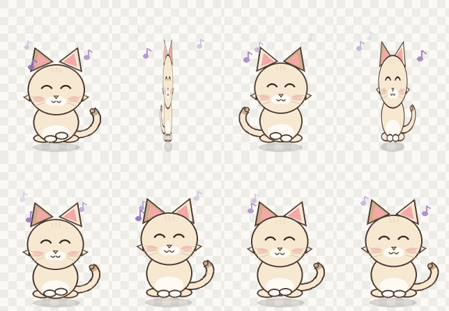
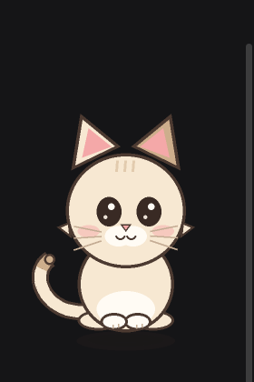

# 泡泡猫 · Windows 桌面浮窗小宠物

一只用纯 Win32 分层窗口 + Pillow 画出来的桌面小宠物。透明浮窗、逐像素点击穿透（透明的地方鼠标可以点到后面的窗口），可以投喂零食、摸头、拖着走，也会自己散步、跳舞。

内置 5 个模型（奶油猫 / 煤球猫 / 布丁狗 / 棉花兔 / 熊猫），还可以把自己的图片变成宠物；大小、透明度、速度、行为开关都能在设置窗口里随时调整。







## 快速开始

双击 **`泡泡猫.vbs`**（无控制台静默启动），或双击 `start.bat`。启动后右键点它，选「设置与自定义…」，或按 `Ctrl+Alt+S` 打开设置窗口。

- 需要 Windows 10/11 + Python 3.14（已带 tkinter，无需安装任何第三方包，Pillow 已随项目放在 `vendor/`）。
- 支持多显示器：小宠物可以走到/被拖到任意一块屏幕上。它按主屏 DPI 渲染，所以在高缩放比例的副屏上会显得略小一点。
- 再次双击不会启动第二只（单实例互斥体，会弹窗提示）。
- 想让它开机自启：按 `Win+R` 输入 `shell:startup`，把 `泡泡猫.vbs` 的快捷方式丢进去即可。

## 玩法 / 操作

| 操作 | 效果 |
| --- | --- |
| **左键单击宠物** | 在它脚边掉一块饼干，宠物会自己走过去吃掉；饱食度 +16、心情 +7 |
| **左键拖动** | 直接把它拎到任意位置（拖动时它会瞪大眼睛「!」） |
| **右键单击** | 打开控制菜单（见下） |
| **Ctrl + Alt + S** | 打开设置窗口 |
| **Ctrl + Alt + D** | 让它跳个舞 |
| **Ctrl + Alt + F** | 在鼠标位置丢一块零食，宠物跑过来吃 |
| 鼠标悬停 | 它会歪头看你（眼睛跟着鼠标转） |
| 长时间不理它 | 会自己趴下睡觉（zzz） |
| 单击桌面空白处 | 默认无反应；开启「单击桌面就投喂」后，20 秒内点桌面任意位置 = 在那里投喂一次 |

### 设置窗口

在设置窗口里改动**立刻生效并自动保存**（写进 `state.json`）：

- **宠物模型**：奶油猫 / 煤球猫 / 布丁狗 / 棉花兔 / 熊猫。
- **自定义图片**：选一张 PNG/JPG 当宠物；默认「自动去白底」，纯白背景会被抠掉，白底图也能贴合桌面。
- **大小**（0.6×–1.8×）、**透明度**（35%–100%）、**走路速度**（0.5×–1.8×）。
- **行为开关**：自由漫游、跟随鼠标、单击桌面就投喂、自动表演、去白底、窗口置顶。
- **动作按钮**：跳舞 / 转圈 / 蹦一蹦 / 打滚 / 投喂一块小饼干。
- **回到右下角 / 恢复默认 / 退出宠物**。
- 底部实时显示饱食度、心情和当前状态。

### 右键菜单

- **设置与自定义…** —— 打开设置窗口。
- **跳个舞** —— 原地跳舞给你看。
- **投喂零食…（点桌面定位）** —— 先选这项，再点桌面上任意位置，饼干就掉在那里，宠物跑过去吃。
- **摸摸头** —— 爱心 + 呼噜声泡，心情 +8。
- **陪它玩一下** —— 原地蹦跶卖萌，心情 +10。
- **去睡觉** —— 立刻趴下睡（点它可叫醒）。
- **跟随鼠标** —— 宠物会跟在鼠标后面小跑；再点一次取消。
- **自由漫游** —— 默认开启，偶尔在桌面散个步；可关闭让它老实待着。
- **单击桌面就投喂** —— 开启后，20 秒内点击桌面任意位置都会在那里掉零食（一次性）。
- **回到屏幕右下角** / **重置状态** / **退出**。
- 「饱食度 / 心情」是灰色只读状态行。

### 动作

- 跳舞：左右摇摆、转身、冒音符（5 秒）。
- 转圈：快速旋转一圈（2.2 秒）。
- 蹦一蹦：原地跳起再落下（1.6 秒）。
- 打滚：缩成一团转一圈（2.4 秒）。
- 开启「自动表演」后，闲着超过 6 秒会随机来一段，间隔 28–70 秒。

## 文件结构

```
desktop-pet/
├─ 泡泡猫.vbs          # 推荐入口：无控制台启动
├─ start.bat           # 备用入口
├─ pet.py              # 主程序：窗口、状态机、交互、菜单、设置接入、持久化
├─ settings.py         # 设置数据 + tkinter 设置窗口（独立线程）
├─ win32.py            # ctypes 封装的 Win32 API（分层窗口/菜单/全局钩子/DPI）
├─ sprite.py           # 用 Pillow 逐帧画宠物、气泡、饼干、爱心、5 种模型
├─ vendor/             # 便携版 Pillow 13（Python 3.14 win_amd64，含 wheel 备份）
├─ state.json          # 自动保存：位置、饱食度、心情、全部设置
├─ pet.log             # 出错时才会生成
├─ preview/            # 姿态图、多模型图、跳舞帧、气泡/饼干渲染图、运行截图
└─ tools/              # preview.py 离线渲染、close_pet.py 优雅关闭、crop.py 截图裁剪
```

## 状态与数值

- 饱食度、心情都是 0–100；关闭程序后按真实小时缓慢下降。
- 饱食度 < 25 时宠物会主动喊饿；心情低时会显得没精神。
- 所有状态和设置自动写入 `state.json`：位置、饱食度、心情、模型、自定义图片、大小/透明度/速度、各开关。

## 调参 / 自定义

- **加一个新模型**：在 `sprite.py` 里照现有 `Skin(...)` 的样子加一条并 `_add_skin(...)`，设置窗口会自动多出一个选项。
- **动作时长/幅度**：`pet.py` 的 `ACTION_SPECS`；画面参数在 `_action_pose()`。
- **配色、脸型、耳朵、尾巴**：`sprite.py` 顶部的调色板与 `_draw_cat()` 里的几何坐标（逻辑画布 260×360，`CAT_DY=20` 是整体下移量）。
- **帧率 / 走路速度 / 吃饭时长 / 漫游间隔**：`pet.py` 里 `SetTimer(..., 33, ...)`、`_start_walk(..., speed=)`、`_start_eat` 的 `self.eat_duration = 1.6`、`_arrive` 与 `_tick` 里的 `random.uniform(10.0, 22.0)`。
- **台词**：`pet.py` 内所有 `self.say("...")` 字符串。
- **饼干样子**：`sprite.py` 的 `render_food()`。

改完直接重启宠物即可，无需重新安装依赖。

## 常见问题

- **宠物不见了？** 可能被拖到屏幕外，或藏在别的窗口后面。右键菜单没法用的话，删除 `state.json` 再启动（会回到右下角）。
- **点击没反应？** 确认点的是宠物身体（透明区域是穿透的，点不到）；或者它正在睡觉——点一下会醒。
- **想彻底关掉？** 右键 → 退出；或任务栏右下角设置窗口里的「退出宠物」；或任务管理器结束 `pythonw.exe`。
- **自定义图片是一块白底？** 确认开启了「自定义图自动去白底」；如果原图背景不是纯白，抠不干净时可以先用图片工具处理成透明 PNG。
- **设置窗口没出现？** 按 `Ctrl+Alt+S`，或右键宠物选「设置与自定义…」；它可能开在屏幕右侧、被其他窗口挡住。
- **报错？** 看同目录 `pet.log`；常见原因是 Python 版本低于 3.10 或缺少 `vendor/` 里的 Pillow。
